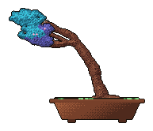

<a href="https://lucasfreitas.me">
  <picture>
    <source media="(prefers-color-scheme: dark)" srcset="assets/header-dark.svg" />
    <source media="(prefers-color-scheme: light)" srcset="assets/header-light.svg" />
    
  </picture>
</a>

  
  
  

### 👋 Hi, I'm Lucas

I rebuild how companies of 50 to 500 people work — AI agents where they pay off, solid engineering everywhere else.

- 🇧🇷 Brazilian, living in **Berlin** for 11+ years
- 💼 Building software professionally since **2012** — Raisin, Mytheresa, Urban Sports Club, Watchmaster
- 🤖 These days: AI agents, workflow automation, internal tools, systems integration
- 🗣️ Portuguese, English, German, and a bit of Chinese

### 🧰 Toolbox

**Languages** 

**Frontend & mobile** 

**Backend & data** 

**Cloud & infra** 

**AI** 

 

### 🌱 Things I've built

- [**rackpool**](https://github.com/lucasff/rackpool) — Shared, encrypted media library where members pool their own disks; erasure-coded shards, rclone/WebDAV access. *Go, prototype*
- [**electron-whatsapp-caller**](https://github.com/lucasff/electron-whatsapp-caller) — Open a WhatsApp chat straight from any `tel:` link. *Electron*

### 💬 Let's talk

Got a process that eats your team's week? [Message me on LinkedIn](https://de.linkedin.com/in/lucasff) and describe it — I'll reply with the questions I'd ask and an honest take on whether it's worth building.

  The tree above re-grows every night from my commit history.
  

